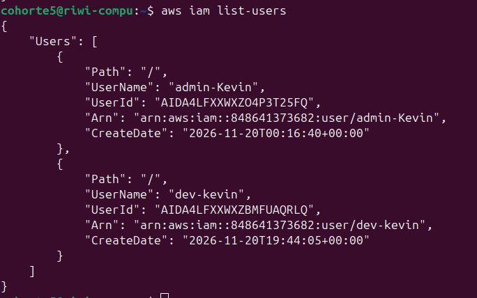
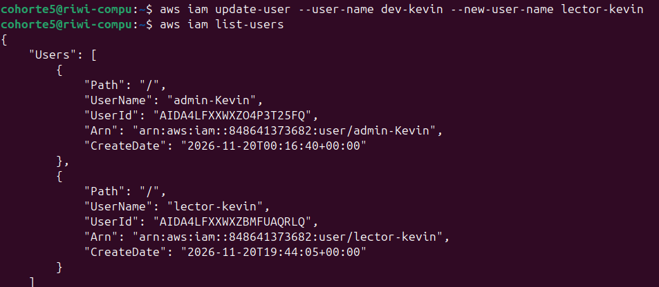
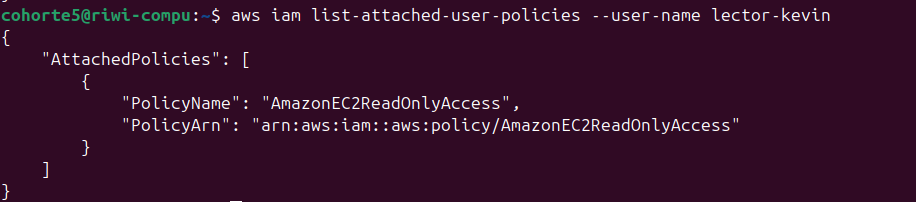
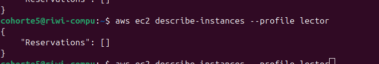
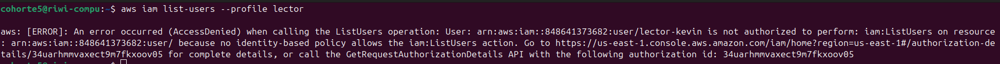
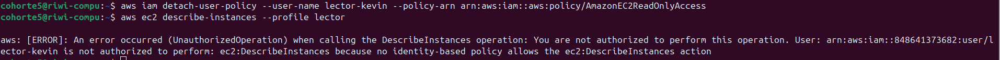
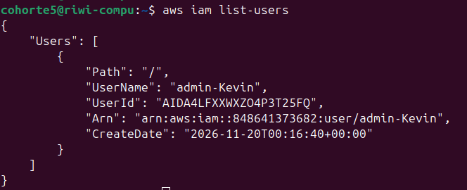

# Evidencia

## Paso 3

## Paso 6

## Paso 8

## Paso 12

## Paso 13

## Paso 15

## Paso 19

---

## Preguntas de reflexión

### 1. ¿Qué podía hacer el usuario justo después de crearlo, antes de adjuntarle una política? ¿Por qué?

No podía hacer ninguna acción sobre recursos o servicios de AWS. Por defecto, AWS IAM aplica una denegación implícita: si no hay una política que permita explícitamente la acción, se deniega.

### 2. En el error del paso 13, ¿qué tres datos te dice el mensaje?

1. El usuario que realiza la petición (`arn:aws:iam::848641373682:user/lector-kevin`).
2. La acción no autorizada (`iam:ListUsers`).
3. El recurso sobre el que se intenta ejecutar (`arn:aws:iam::848641373682:user/`).

### 3. ¿Por qué cambió el Arn al renombrar el usuario?

Porque el ARN del usuario IAM incluye su nombre (`UserName`) al final (`arn:aws:iam::<account-id>:user/<UserName>`). Al cambiar de `dev-kevin` a `lector-kevin`, cambia el ARN, mientras que el `UserId` (`AIDA4LFXXWXZBMFUAQRLQ`) sigue siendo el mismo.

### 4. ¿Por qué AWS obliga a borrar las llaves antes de borrar el usuario?

Por seguridad y control de credenciales, para no dejar llaves de acceso activas o huérfanas asociadas a un usuario eliminado y asegurar que se revoque el acceso programático antes de borrar la identidad.

### 5. ¿Qué pasaría si le hubieras dado AdministratorAccess en vez de solo lectura? ¿En qué caso real estaría justificado?

Tendría permisos totales sobre la cuenta de AWS, con el riesgo de modificar o borrar recursos críticos o comprometer toda la cuenta si se filtran sus credenciales. Solo estaría justificado para un administrador que requiera gestionar toda la cuenta (idealmente con MFA, acceso temporal/roles y auditoría).
