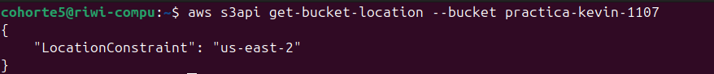
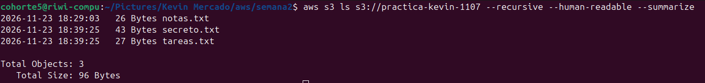
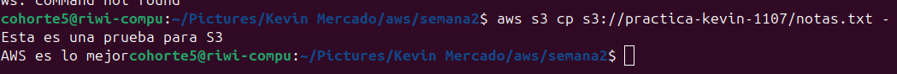
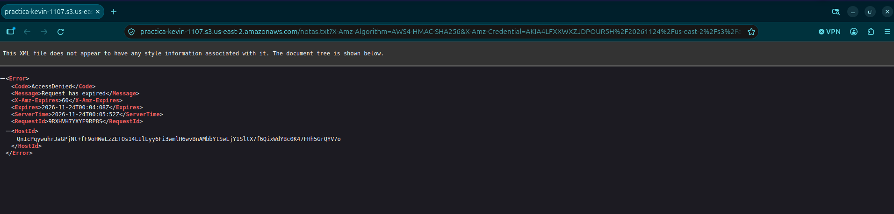
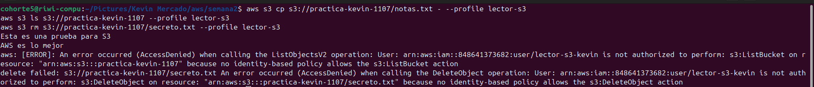
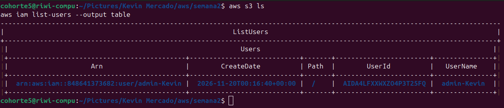

# Práctica Amazon S3 e IAM — Evidencias y Reflexión

**Autor:** Kevin Mercado[cite: 1, 5]  
**Bucket de prueba:** `practica-kevin-1107`[cite: 1, 2, 4]  
**Usuario IAM de prueba:** `lector-s3-kevin`[cite: 4]

> **Nota de seguridad:** Este documento no contiene claves secretas (`SecretAccessKey`) ni información sensible.

---

## Evidencias de la práctica

### Paso 3

### Paso 7

### Paso 13

### Paso 16

### Pasos 21, 22 y 23

### Paso 29

---

## Preguntas de reflexión

### 1. ¿Por qué el nombre de tu bucket tuvo que ser distinto al de tus compañeros si cada uno tiene su propia cuenta?

Porque los nombres de buckets en Amazon S3 comparten un espacio de nombres **global** (dentro de la partición de AWS), no solo por cuenta o región. Al crearse, cada bucket queda identificado globalmente, por lo que dos cuentas distintas no pueden usar el mismo nombre al mismo tiempo.

### 2. El usuario del paso 21 pudo leer un archivo, pero en el paso 22 no pudo ver la lista. ¿Qué acción le faltaba en la política?

Le faltaba la acción **`s3:ListBucket`** (asociada al ARN del bucket, como `arn:aws:s3:::practica-kevin-1107`[cite: 4]). La política solo concedía `s3:GetObject`[cite: 3], permiso suficiente para leer objetos específicos, pero no para listar el contenido del bucket.

### 3. En la política, ¿qué significa el `/*` al final del `Resource`? ¿Qué pasaría si se quitara?

El `/*` indica que el permiso aplica a **todos los objetos (claves)** alojados dentro del bucket (`arn:aws:s3:::practica-kevin-1107/*`[cite: 3, 4]). Si se quitara y quedara únicamente `arn:aws:s3:::practica-kevin-1107`[cite: 4], la acción `s3:GetObject` no coincidiría con las rutas de los objetos dentro del bucket, por lo que intentar leer `notas.txt` fallaría con `AccessDenied`.

### 4. ¿En qué se diferencia compartir un archivo con un enlace temporal de hacer público el bucket?

- **Enlace temporal (URL prefirmada):** Permite descargar o ver un objeto concreto durante un tiempo limitado (por ejemplo, 60 segundos) mediante una firma temporal, sin abrir el bucket ni exponer los demás archivos. Al vencer el plazo, el enlace deja de funcionar.
- **Hacer público el bucket:** Modifica la configuración o políticas de acceso para permitir que usuarios no autenticados de internet accedan según las reglas públicas definidas, lo cual supone un alcance mucho más amplio y persistente que un enlace con caducidad.

### 5. Según el modelo de responsabilidad compartida, si alguien deja un bucket público con datos de clientes, ¿de quién es la responsabilidad?

Es responsabilidad **del cliente**. AWS se encarga de la _seguridad de la nube_ (infraestructura física, hardware, redes y servicios subyacentes), mientras que el cliente es responsable de la _seguridad en la nube_, incluida la correcta configuración de permisos, políticas de acceso y controles de privacidad sobre sus datos y buckets de S3.
