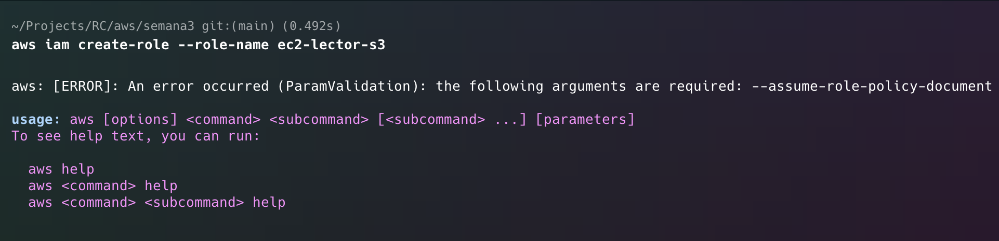
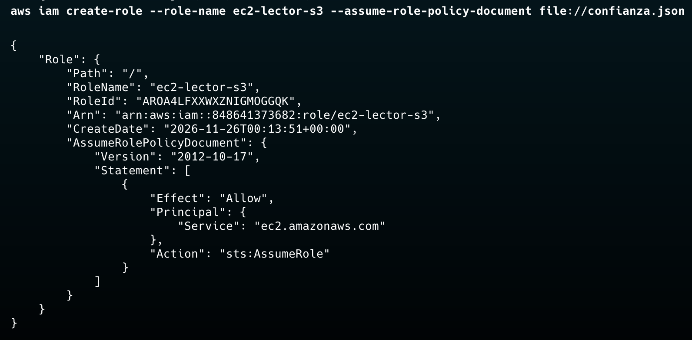
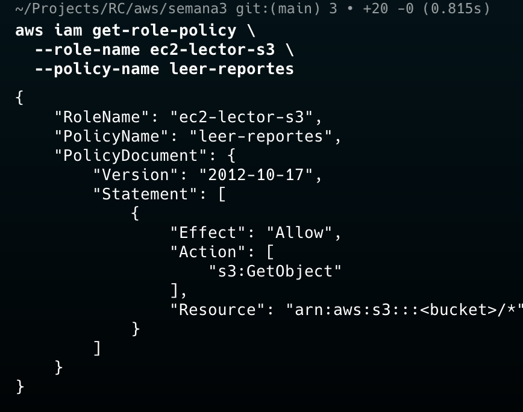
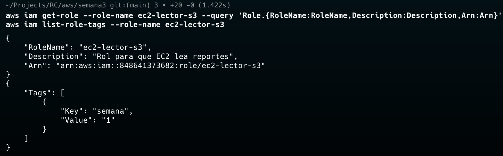
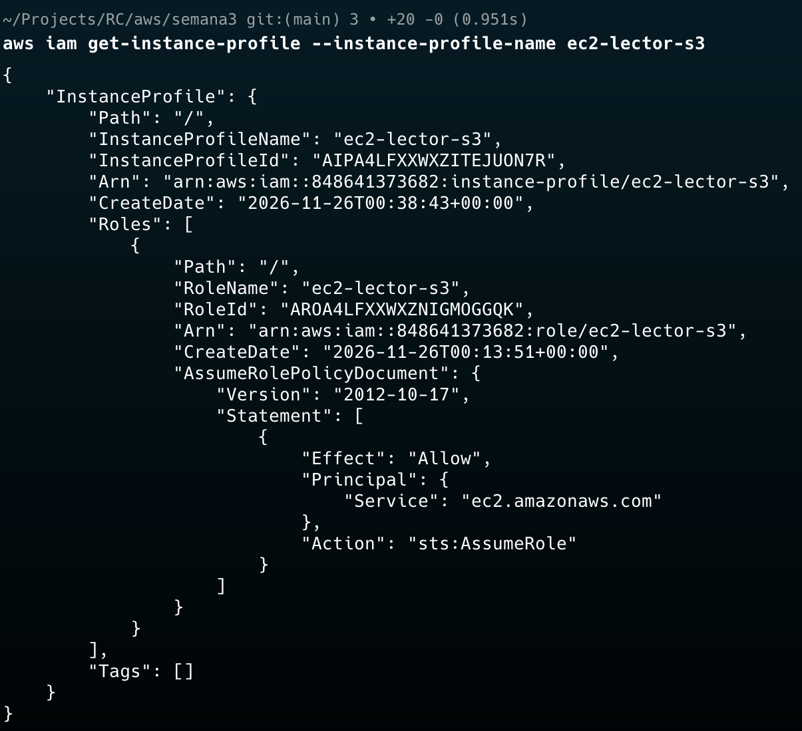
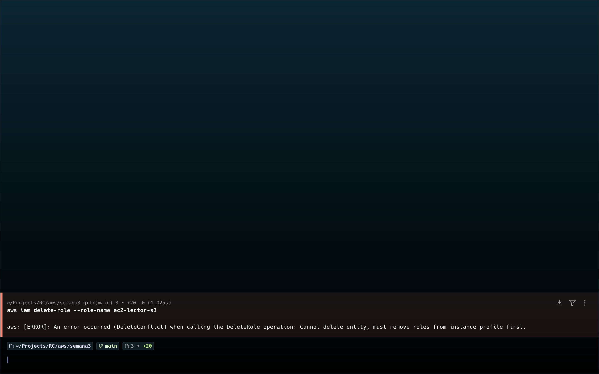

# Evidencia - Práctica Roles de IAM

## Capturas de pantalla

### Parte 3

### Parte 7

### Parte 13

### Parte 16

### Parte 19

### Parte 20

---

## Preguntas de reflexión

### 1. ¿Qué diferencia hay entre la política de confianza y la política de permisos? ¿Qué pasaría si el rol tuviera solo una de las dos?

- **Política de confianza (`AssumeRolePolicyDocument`):** Define **quién** puede asumir el rol (en este caso, únicamente el servicio `ec2.amazonaws.com`).
- **Política de permisos:** Define **qué acciones y sobre qué recursos** puede realizar quien asuma el rol (`s3:GetObject` sobre los objetos del bucket).
- **Si tuviera solo una de las dos:**
  - Con **solo política de confianza**, la instancia EC2 podría asumir el rol, pero no tendría permisos para ejecutar ninguna acción en AWS (todo estaría denegado por defecto).
  - Con **solo política de permisos**, ninguna entidad tendría autorización para asumir el rol, por lo que nadie podría utilizar esos permisos.

### 2. ¿Por qué es más seguro que la instancia use un rol en vez de guardar una llave de acceso con `aws configure`?

Porque un rol proporciona **credenciales temporales** que rotan automáticamente a través del servicio de metadatos de EC2, evitando almacenar claves estáticas (`Access Key ID` y `Secret Access Key`) en el disco o en variables de entorno de la instancia, lo que reduce el riesgo de filtración y facilita la gestión de accesos.

### 3. Con la política `leer-reportes`, ¿la instancia podrá listar el contenido del bucket? ¿Y borrar `reporte.txt`? Explica por qué.

- **Listar el contenido del bucket:** **No**, porque esa operación requiere el permiso `s3:ListBucket` sobre el ARN del bucket (`arn:aws:s3:::reportes-<tu-nombre>-<número>`), el cual no está incluido en la política.
- **Borrar `reporte.txt`:** **No**, porque eliminar un objeto requiere el permiso `s3:DeleteObject` y la política concede únicamente `s3:GetObject`. En IAM, cualquier acción no permitida explícitamente queda denegada.

### 4. En el error del paso 20, ¿qué le falta por hacer antes de poder borrar el rol?

Antes de eliminar el rol con `aws iam delete-role`, es necesario **desasociar el rol del perfil de instancia** usando `aws iam remove-role-from-instance-profile` (y eliminar también las políticas en línea o administradas vinculadas al rol).

### 5. Si mañana la instancia también necesita subir archivos al bucket, ¿qué cambiarías y en cuál de los dos archivos?

Modificaría el archivo **`permisos.json`** (actualizando después la política en línea del rol) para agregar la acción `s3:PutObject` sobre el recurso `arn:aws:s3:::reportes-<tu-nombre>-<número>/*`. El archivo `confianza.json` no se modifica porque la entidad que asume el rol sigue siendo el servicio EC2.
