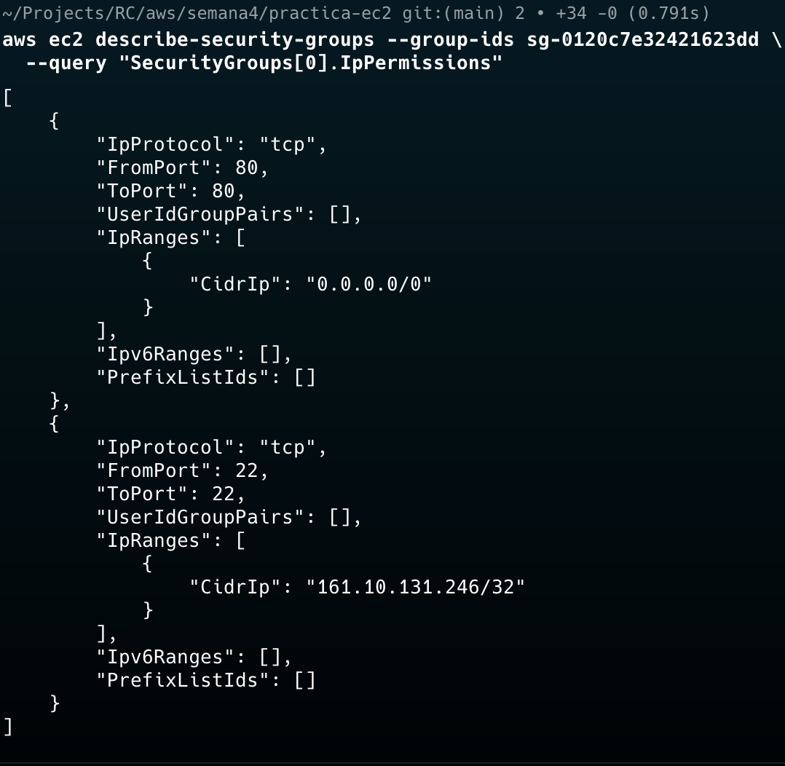
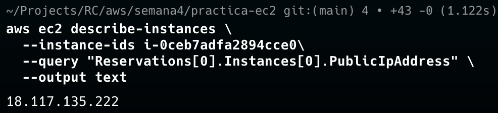
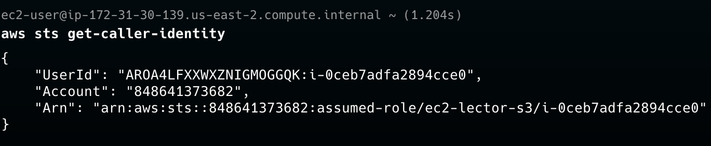
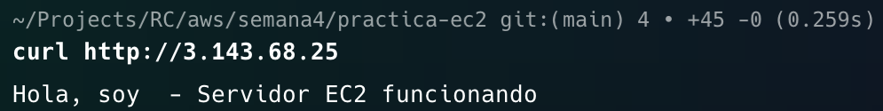
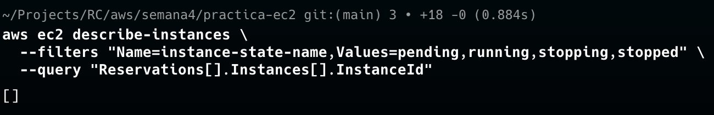

# Evidencia: Tu primer servidor en EC2

## Capturas de pantalla (`Parte*.png`)

## Preguntas de reflexión

1. **En el paso 20, la instancia responde con un rol y no con un usuario. ¿De dónde sacó esas credenciales si nunca corriste `aws configure`?**

   Las obtiene automáticamente a través del servicio de metadatos de la instancia (**IMDS**) mediante el perfil de instancia (`ec2-lector-s3`) vinculado al rol de IAM, que entrega credenciales temporales rotativas sin guardar llaves estáticas en la instancia ni ejecutar `aws configure`.

2. **¿Por qué el puerto 80 puede estar abierto a todo internet y el 22 no?**

   El puerto 80 es para tráfico HTTP público hacia el servidor web, mientras que el puerto 22 (SSH) permite administración remota del sistema; abrirlo a `0.0.0.0/0` expondría la máquina a intentos de acceso o fuerza bruta desde cualquier origen, por lo que se restringe a mi IP (`/32`).

3. **La instancia pudo leer `reporte.txt` pero no listar el bucket. ¿Dónde se decidió eso?**

   En la política de IAM asociada al rol `ec2-lector-s3`, donde se concedió permiso para leer el objeto (`s3:GetObject` sobre `reporte.txt`), pero no para listar el bucket (`s3:ListBucket`).

4. **¿Por qué cambió la IP pública al apagar y encender? ¿Qué problema traería eso en un sitio web real?**

   Porque al detener (`stop`) una instancia EC2 sin una IP Elástica (Elastic IP), AWS libera la IPv4 pública dinámica y asigna otra al encenderla (`start`). En un sitio web real, si el dominio o los usuarios apuntan a la IP anterior, el servicio dejaría de cargarse hasta actualizar el DNS o usar una Elastic IP / balanceador.

5. **EC2 es infraestructura como servicio (IaaS). En esta práctica, ¿qué fue responsabilidad tuya y qué fue responsabilidad de AWS?**

   Responsabilidad mía: configurar el Security Group, el perfil/rol de IAM, el script `inicio.sh`, el servicio web y la limpieza de recursos. Responsabilidad de AWS: el hardware físico, la virtualización/hipervisor, la red subyacente, la disponibilidad de la infraestructura y la entrega de credenciales temporales mediante el rol.

6. **Para tener este mismo servidor en una oficina, sin la nube, ¿qué habrías tenido que comprar y configurar?**

   Comprar el servidor físico, respaldo eléctrico (UPS), enlace de internet con IP pública y firewall/router, además de instalar y mantener el sistema operativo, configurar la red y reglas de acceso, y ocuparme de la seguridad física y el mantenimiento.
